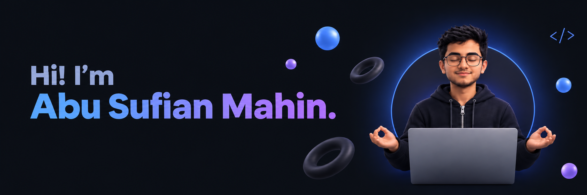

  

  

<h4 align="center">───&nbsp;&nbsp; A B O U T &nbsp;&nbsp;───</h4>

  Hi, I'm <b>Abu Sufian Mahin</b> — a Computer Science & Engineering undergrad at <b>BRAC University</b>, Bangladesh. 
  I build full-stack web applications, from clean, responsive interfaces to the APIs and databases behind them. 
  I enjoy turning ideas into products that feel simple to use, and I care about code that is just as easy to read.

<!-- 

  <i>"Write code for humans first, machines second."</i>

 -->

 

<h4 align="center">───&nbsp;&nbsp; W H A T &nbsp; I &nbsp; D O &nbsp;&nbsp;───</h4>

  <b>Frontend</b> &nbsp;—&nbsp; Fast, responsive interfaces with React, Next.js & Tailwind CSS 
  <b>Backend</b> &nbsp;—&nbsp; REST APIs and server logic with Node.js & Express 
  <b>Databases</b> &nbsp;—&nbsp; Data modeling with MongoDB, MySQL & Firebase 
  <b>Problem Solving</b> &nbsp;—&nbsp; Scripting and algorithmic challenges in Python

 

<h4 align="center">───&nbsp;&nbsp; S T A C K &nbsp;&nbsp;───</h4>

  

 

<h4 align="center">───&nbsp;&nbsp; N O W &nbsp;&nbsp;───</h4>

  

  Adding <b>TypeScript</b> to my Next.js projects for safer, more scalable code 
  Exploring <b>PostgreSQL</b> alongside the databases I already use 
  Learning <b>Docker</b> and <b>AWS</b> to containerize and deploy apps to the cloud 
  Sharpening <b>data structures & algorithms</b> to strengthen my fundamentals

 

<h4 align="center">───&nbsp;&nbsp; A C T I V I T Y &nbsp;&nbsp;───</h4>

  

 

<h4 align="center">───&nbsp;&nbsp; L E T ' S &nbsp; C O N N E C T &nbsp;&nbsp;───</h4>

  &nbsp;
  &nbsp;
  &nbsp;
  

